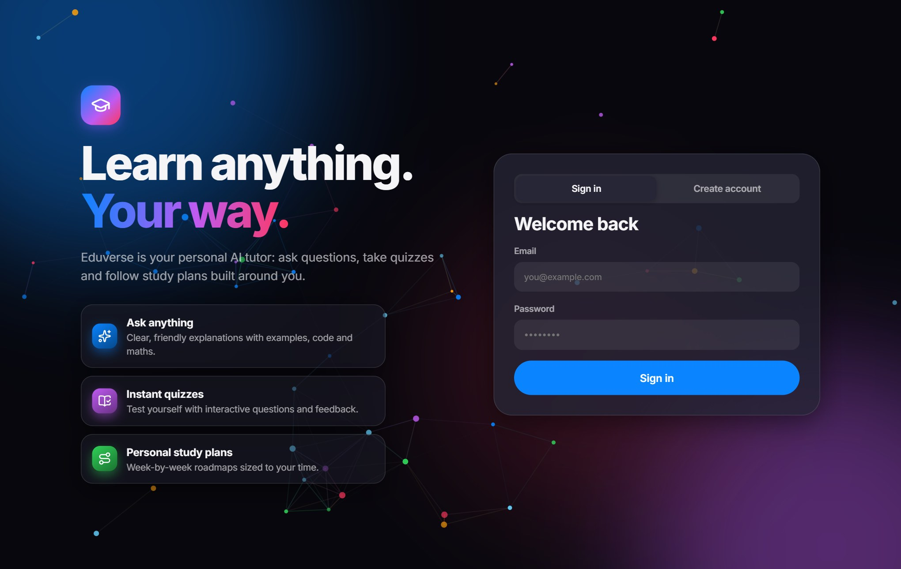
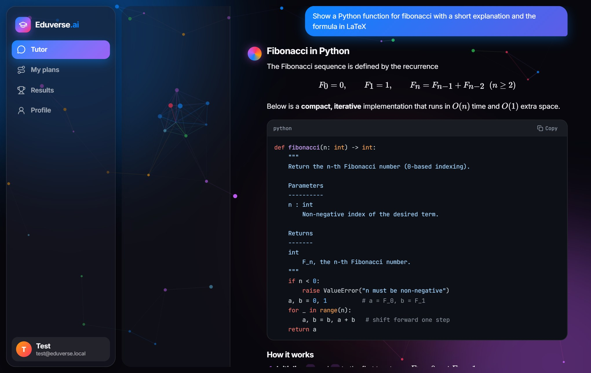
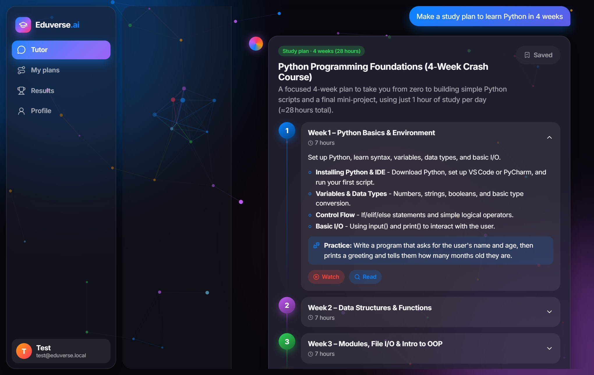
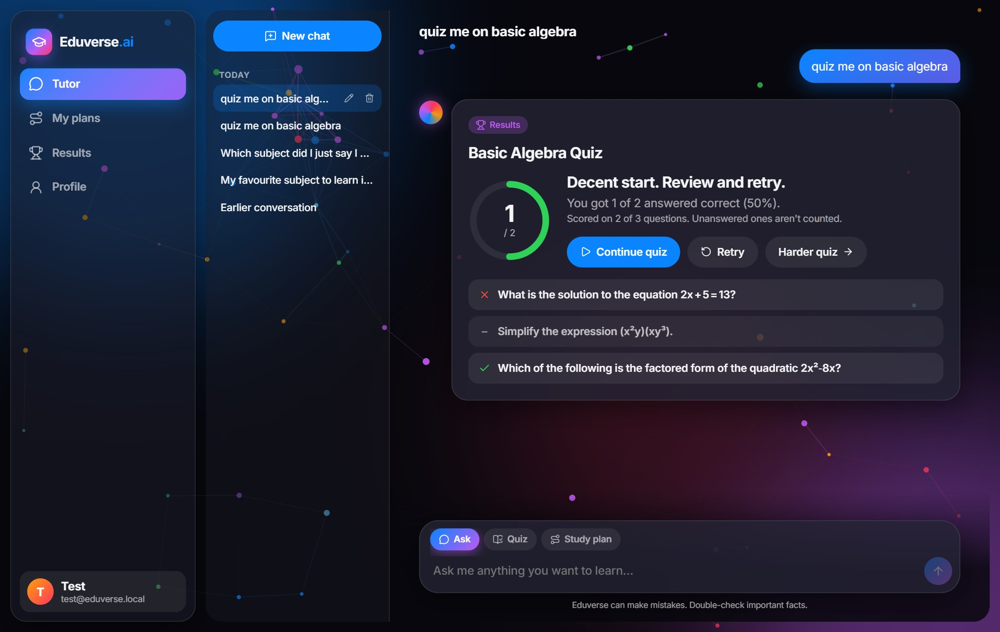
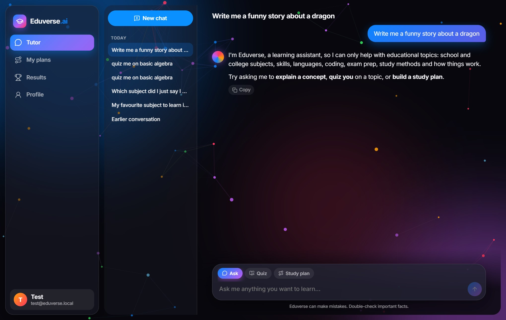
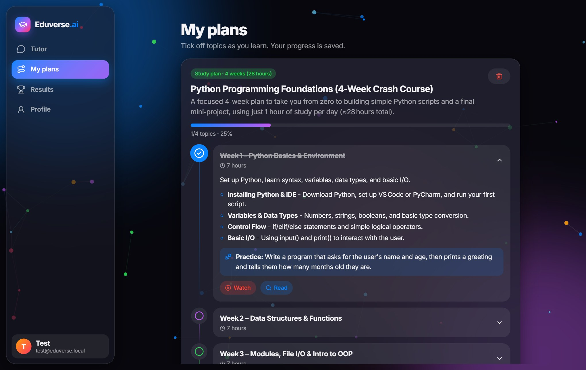
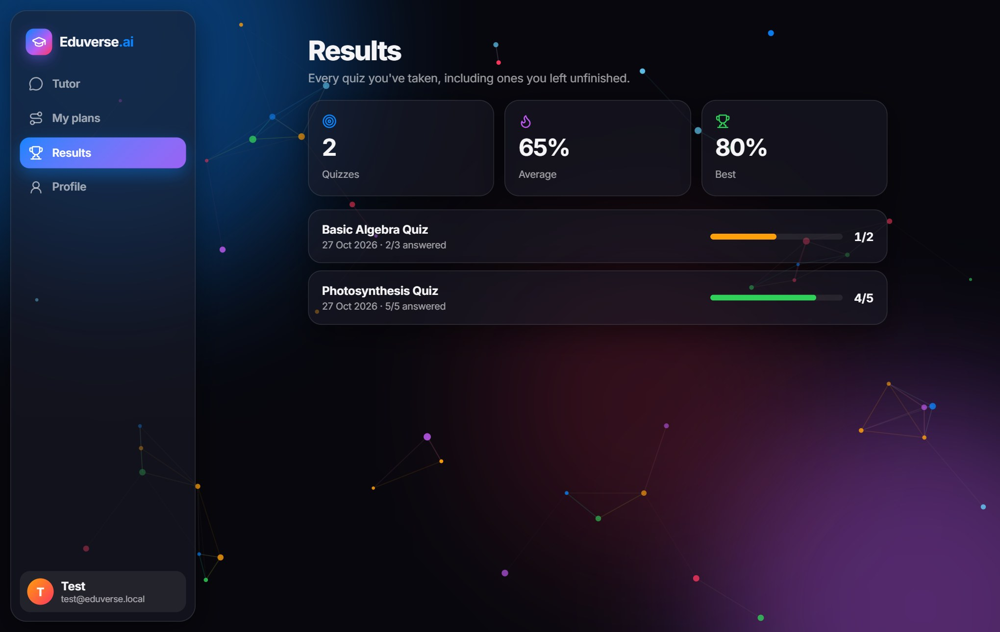
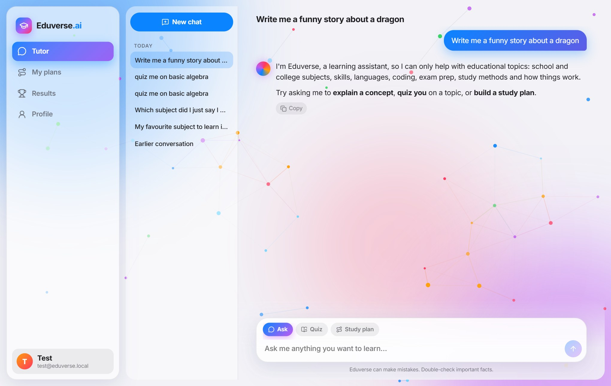
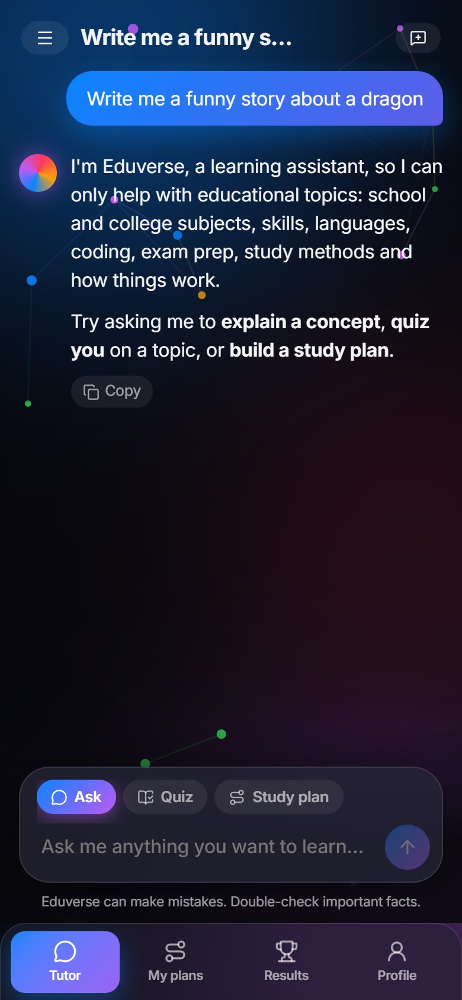

# Eduverse.ai

An AI tutor that **only teaches**: streaming chat, interactive quizzes and personalised study plans, wrapped in a modern glass UI with a living particle background.



## Features

- **Streaming tutor chat** with Markdown, syntax-highlighted code (copy button), tables and LaTeX maths
- **Multiple independent chats**: each conversation has its own context, so you can revisit and continue any topic. Rename or delete chats from the sidebar
- **Interactive quizzes** with instant feedback and explanations. Answers save as you go, and a half-finished quiz is scored on what you answered (e.g. 2/3)
- **Study plans** as a timeline with sub-topics, practice tasks and search links. Save them to **My plans** and tick topics off to track progress
- **Results** page with every quiz you have taken, average and best score
- **Education-only guard rails and anti-hallucination layers** (see below)
- Personalised by role, age group, language and daily study time
- Light and dark themes, fully responsive (mobile tab bar and chat drawer)

| Chat with code and maths | Study plan card |
| --- | --- |
|  |  |

| Quiz with partial scoring | Education-only guard |
| --- | --- |
|  |  |

| My plans with progress | Quiz results |
| --- | --- |
|  |  |

| Light theme | Mobile |
| --- | --- |
|  |  |

## How the guard layers work

Every request passes through separate models before and after the tutor, so the tutor is never the only line of defence.

1. **Pattern filter**: instantly refuses obvious jailbreak / "reveal your prompt" attempts.
2. **Scope classifier**: a separate model decides whether the message is about learning (fails closed).
3. **Hardened tutor prompt**: no invented facts, sources or URLs; admits uncertainty; ignores instructions inside user messages.
4. **Answer fact-check**: a second model reviews each answer. The UI shows "Fact-checked" or lists specific claims worth double-checking; off-topic output is replaced with a refusal.
5. **Quiz verification**: each question is solved independently, and questions whose answer key disagrees are dropped.

Refused turns are stored but never fed back into the model's context.

## Tech stack

| Layer | Technology |
| --- | --- |
| Frontend | React 19, Vite 8, react-router, tsParticles, react-markdown + KaTeX + highlight.js |
| Backend | FastAPI, async PyMongo, JWT (PyJWT) + bcrypt, Server-Sent Events |
| Database | MongoDB (`users`, `chats`, `messages`, `plans`, `quiz_results`) |
| AI | Groq API. Tutor: `MODEL_NAME` (default `openai/gpt-oss-120b`). Guard layers: `GUARD_MODEL` (default `openai/gpt-oss-20b`) |
| Deploy | Docker, Render (single service) |

## Run locally

Prerequisites: Python 3.12+, Node 22+, a MongoDB connection string (Atlas free tier works) and a [Groq API key](https://console.groq.com).

```sh
cp .env.example .env          # fill in MONGO_URI, API_KEY, JWT_SECRET
python -m venv venv
venv\Scripts\activate          # source venv/bin/activate on macOS/Linux
pip install -r requirements.txt
uvicorn app.main:app --reload --port 8000

cd frontend
npm install
npm run dev                    # http://localhost:5173 (proxies /api to :8000)
```

To serve everything from one process, run `npm run build` in `frontend/` and open http://localhost:8000.

### Environment variables

| Variable | Default | Purpose |
| --- | --- | --- |
| `MONGO_URI` | required | MongoDB connection string |
| `MONGO_DB` | `eduverse` | Database name |
| `API_KEY` | required | Groq API key |
| `MODEL_NAME` | `openai/gpt-oss-120b` | Tutor model |
| `GUARD_MODEL` | `openai/gpt-oss-20b` | Scope check, fact-check and quiz verification model |
| `JWT_SECRET` | random per boot | Set a long random value in production |
| `CORS_ORIGINS` | localhost dev origins | Only needed if the frontend is hosted elsewhere |
| `RATE_LIMIT_PER_MIN` | `20` | Per-user limit on AI requests |

## Deploy on Render

1. Push this repo to GitHub, then in Render choose **New → Blueprint** and select it (`render.yaml`).
2. Set the secret env vars `MONGO_URI` and `API_KEY`. `JWT_SECRET` is generated for you.
3. In MongoDB Atlas → **Network Access**, allow Render (add `0.0.0.0/0`, or Render's outbound IPs).
4. Check `https://<your-service>.onrender.com/api/health` after the deploy finishes.

The Dockerfile builds the frontend and serves it from FastAPI, so it is a single service with no CORS setup.

## API

| Method | Path | Purpose |
| --- | --- | --- |
| POST | `/api/auth/signup`, `/api/auth/login` | Create account / sign in (returns JWT) |
| GET / PUT | `/api/auth/me`, `/api/auth/preferences` | Profile and learning preferences |
| POST | `/api/chat/stream` | `{message, mode: chat\|quiz\|plan, chat_id?}` → SSE stream (`start`, `delta`, `status`, `block`, `checking`, `review`, `done`, `error`) |
| GET | `/api/chats`, `/api/chats/{id}/messages` | Chat list and messages |
| PATCH / DELETE | `/api/chats/{id}` | Rename / delete a chat |
| GET / POST / DELETE | `/api/plans`, `/api/plans/{id}` | Saved study plans |
| PUT | `/api/plans/{id}/topics/{index}` | Mark a topic done / not done |
| POST / GET | `/api/quiz/submit`, `/api/quiz/results` | Save answers (partial allowed) / list results |
| GET | `/api/health` | Health check |

## Project structure

```
app/                 FastAPI backend (routers, guard layers, prompts, LLM client)
frontend/src/        React app (pages, components, chat state, API client)
docs/screenshots/    README images
Dockerfile           Multi-stage build (Vite build → Python runtime)
render.yaml          Render blueprint
```

## License

MIT
